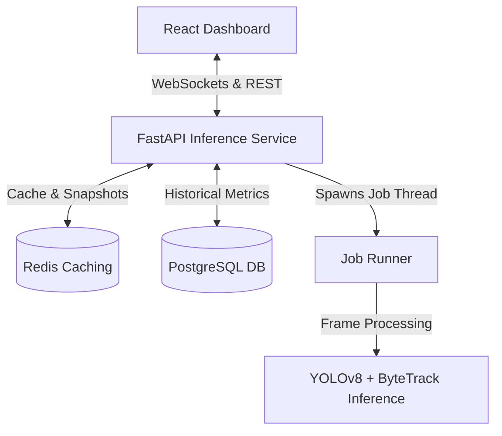

# VoxelQ

[](https://opensource.org/licenses/MIT)
[](https://www.python.org/downloads/)
[](https://react.dev/)
[](https://www.docker.com/)

VoxelQ is an enterprise-grade, real-time spatial occupancy tracking and queue length estimation platform. Using advanced computer vision (YOLOv8 + ByteTrack), geometric zone tracking, and mathematical queue estimation, VoxelQ translates raw video feeds into actionable operational metrics.

---

## Key Capabilities

*   **Dynamic Polygon Zone Tracking:** Real-time point-in-polygon object checks map detected coordinates to configurable regions.
*   **Wait-Time Estimation:** Employs a rolling-window implementation of Little’s Law ($W = L / \lambda$) to calculate accurate, live wait-time metrics.
*   **Boundary Jitter Mitigation:** A custom `ArrivalFilter` debounces person trajectories across region boundaries, preventing false entrance/exit counts.
*   **High-Performance Streaming:** WebSocket-driven live updates coupled with immediate Redis snapshot caching.
*   **Operational Dashboard:** Modern dashboard featuring time-series metrics, historical comparisons, and density band classifications (Low/Medium/High).

---

## System Architecture



---

## Tech Stack

| Component | Technology |
| :--- | :--- |
| **Detection & Tracking** | Ultralytics YOLOv8n, ByteTrack Multi-Object Tracker, OpenCV |
| **Inference Service** | Python, FastAPI, SQLAlchemy, Uvicorn |
| **Frontend Dashboard** | React 19, Vite, TypeScript, Tailwind CSS, Recharts |
| **Data & Cache Storage** | PostgreSQL 16 (Metrics), Redis 7 (Snapshots & Pub/Sub) |
| **Containerization** | Docker, Docker Compose |

---

## Getting Started

### Prerequisites
*   [Docker](https://www.docker.com/) and Docker Compose installed.

### Quick Start
To spin up the entire cluster (Inference API, React Frontend, PostgreSQL, and Redis):

```bash
docker-compose up --build
```

Once running, access the services:
*   **Frontend Dashboard:** `http://localhost:5173`
*   **Inference API:** `http://localhost:8000`
*   **API Health:** `http://localhost:8000/health`

---

## Core API Reference

| Endpoint | Method | Description |
| :--- | :--- | :--- |
| `/health` | `GET` | Verifies system health status |
| `/videos/start` | `POST` | Initiates a video processing tracking job |
| `/videos/{job_id}/status` | `GET` | Fetches the current state of a tracking job |
| `/videos/{job_id}/metrics` | `GET` | Retrieves historical tracking metrics from PostgreSQL |
| `/videos/{job_id}/stream` | `WS` | WebSocket endpoint for real-time telemetry streaming |

---

## Calibration & Validation

VoxelQ has been rigorously validated against baseline camera configurations:

*   **Clip 1 (High-Occupancy Plaza):**
    *   *MAE (Mean Absolute Error):* 3.83 people
    *   *MAPE (Mean Absolute Percentage Error):* 19.7%
    *   *Characteristics:* Highly resilient under occlusion and tracking merges.
*   **Clip 2 (Low-Occupancy Queue Lane):**
    *   *MAE:* 1.20 people
    *   *MAPE:* 40.7% (reflects small absolute baseline count of 2-5 people)
